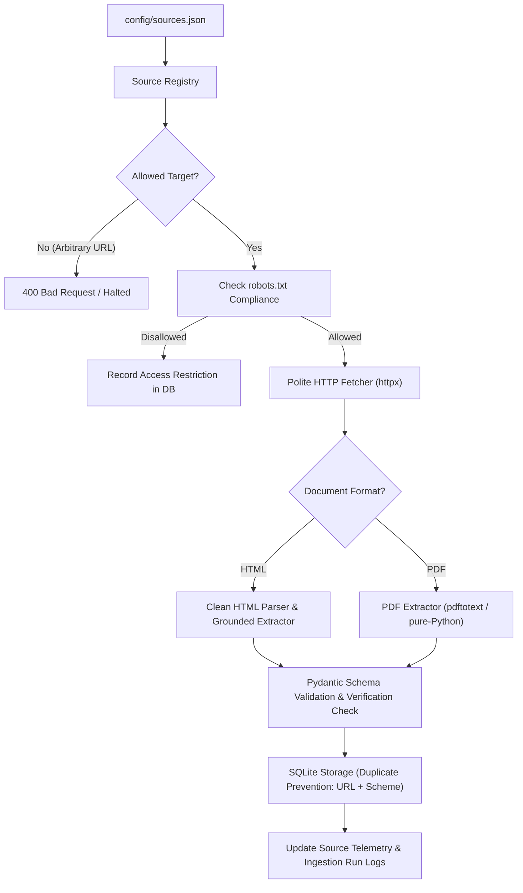

# Team Innovision

# ScholarLens 🎓 

**ScholarLens** is an open-source platform designed to help Indian students discover scholarship opportunities from authoritative government sources (e.g., National Scholarship Portal, UGC, AICTE, and Ministry websites). Records are labelled with their verification status; information is not presented as verified unless it meets the project's evidence checks.

To prevent hallucinations, ScholarLens enforces strict schema validation, source URL tracking, verbatim quotation citations from official circulars, and transparent verification statuses.

---

## 📁 Project Architecture & Structure

```
.
├── config/
│   └── sources.json             # Configurable official scholarship portals (HTML & PDF)
├── data/
│   └── scholarlens.db           # Persistent SQLite database (sources, runs, records)
├── backend/
│   ├── app/
│   │   ├── __init__.py
│   │   ├── config.py            # App settings, timeouts, user-agent, and source loader
│   │   ├── main.py              # FastAPI endpoints for sources, ingestion, and records
│   │   ├── db/
│   │   │   ├── __init__.py
│   │   │   └── database.py      # SQLite operations with duplicate prevention & quality audit
│   │   ├── ingestion/
│   │   │   ├── __init__.py
│   │   │   ├── quality.py       # Data quality rules, date normalization, & verification evaluation
│   │   │   ├── registry.py      # Source registry & arbitrary-target restriction
│   │   │   ├── fetcher.py       # Polite HTTP fetcher (robots.txt, retries, headers)
│   │   │   ├── pipeline.py      # End-to-end ingestion and verification orchestrator
│   │   │   └── extractors/
│   │   │       ├── __init__.py
│   │   │       ├── html_extractor.py # Clean HTML text and grounded scheme extraction
│   │   │       └── pdf_extractor.py  # PDF text and circular extraction (pdftotext + fallback)
│   │   └── schemas/
│   │       ├── __init__.py
│   │       └── scholarship.py   # Pydantic schemas with field-level evidence and verification notes
│   └── tests/
│       ├── __init__.py
│       ├── test_scholarship_schema.py       # Phase 1 schema validation tests (11 tests)
│       ├── test_ingestion_pipeline.py       # Phase 2 pipeline and polite crawler tests (14 tests)
│       └── test_data_quality_verification.py # Phase 3 quality & conservative verification tests (16 tests)
├── frontend/
│   ├── __init__.py
│   └── app.py                  # Streamlit UI (records, registry, ingestion trigger, telemetry)
├── .env.example                 # Example environment variables
├── .gitignore                   # Git ignore rules
├── requirements.txt             # Project dependencies
└── README.md                    # Project documentation
```

---

## 🏛️ Ingestion Pipeline (Phase 2)



### Supported Source Formats
1. **HTML Web Pages**: Extracted using standard library `HTMLParser`. Strips scripts, styles, navigation, and boilerplate; parses headings, paragraphs, and eligibility lists.
2. **PDF Documents & Circulars**: Extracted using system `pdftotext` (Poppler) with an internal pure-Python stream text decoding fallback.

---

## 📋 Scholarship Record Schema

Every scholarship record must adhere to the `ScholarshipRecord` Pydantic schema:

| Field Name | Type | Description |
| :--- | :--- | :--- |
| `scheme_name` | `str` | Official name of the scholarship scheme |
| `government_authority` | `str` | Sponsoring Ministry, Department, or State Board |
| `description` | `str` | Objectives and overview of the scheme |
| `eligibility_criteria` | `List[str]` | Grounded eligibility conditions (marks, income, category) |
| `scholarship_amount` | `Optional[str]` | Financial benefit, tuition fee waiver, or stipend (or None if unavailable/malformed) |
| `application_deadline` | `Optional[str]` | Normalized ISO deadline (YYYY-MM-DD) if established |
| `application_deadline_raw` | `Optional[str]` | Verbatim original deadline text from source as evidence |
| `required_documents` | `List[str]` | Mandatory application documents |
| `official_source_url` | `HttpUrl` | Direct link to official government portal or circular |
| `supporting_quotations`| `List[str]` | Verbatim quotes from the official portal verifying details |
| `field_evidence` | `Dict[str, str]` | Specific verbatim evidence citations for each field |
| `last_verified_timestamp`| `Optional[datetime]`| UTC timestamp when details were verified |
| `verification_status` | `VerificationStatus` | State: `unverified`, `pending`, `verified`, `flagged`, `expired` |
| `verification_notes` | `Optional[str]` | Transparent explanation of verification assessment |

---

## ⚙️ Installation & Setup

### 1. Prerequisites
- Python 3.10+
- Optional: `poppler-utils` (`pdftotext`) for enhanced PDF text extraction on Linux:
  ```bash
  sudo apt-get install poppler-utils
  ```

### 2. Virtual Environment Setup
```bash
python3 -m venv .venv
source .venv/bin/activate
pip install -r requirements.txt
cp .env.example .env
```

---

## 🚀 Running the Application & Ingestion

### 1. Start the FastAPI Backend
```bash
uvicorn backend.app.main:app --reload --host 127.0.0.1 --port 8000
```
- Interactive API Docs (Swagger UI): [http://127.0.0.1:8000/docs](http://127.0.0.1:8000/docs)
- Health Check: [http://127.0.0.1:8000/health](http://127.0.0.1:8000/health)

### 2. Start the Streamlit Frontend
In a separate terminal (with virtual environment activated):
```bash
streamlit run frontend/app.py --server.address 127.0.0.1 --server.port 8501
```
- Open browser at: [http://localhost:8501](http://localhost:8501)

The frontend reads `BACKEND_API_URL` (default: `http://127.0.0.1:8000`). Backend settings such as
`DATABASE_PATH`, `SOURCES_CONFIG_PATH`, `BACKEND_HOST`, `BACKEND_PORT`, and `BACKEND_CORS_ORIGINS`
are read from the environment or `.env`. Running `python -m backend.app.main` starts the API using
the configured host and port. Relative paths are resolved from the directory where the app starts.

### Deploy with Docker Compose

Docker Engine and the Docker Compose plugin are required. This setup runs the API and Streamlit
frontend as separate containers, serves the UI on port 8501, and stores the SQLite database in a
persistent Docker volume.

1. Copy `.env.example` to `.env` and set `FRONTEND_PUBLIC_URL` to the UI's public origin (scheme
   and host, without a path). For example, use `https://scholar.example.com` when a reverse proxy
   provides HTTPS.
2. From the repository directory, build and start both services:

   ```bash
   docker compose up --build -d
   ```

3. Check service health and logs:

   ```bash
   docker compose ps
   docker compose logs -f backend frontend
   ```

4. Open `http://localhost:8501` (or your configured public URL). The API health check is at
   `http://localhost:8000/health` when the API port is exposed.

The compose file configures the API to listen on all container interfaces, points the frontend
to the backend service by its Compose name, restricts CORS to `FRONTEND_PUBLIC_URL`, and stores
the database at `/data/scholarlens.db` on the `scholar_data` volume. Back up that volume regularly;
removing it deletes the stored records and ingestion history. For a public deployment, place the
services behind a TLS-enabled reverse proxy, expose only the ports you need, use a persistent
host/volume, forward WebSocket connections for Streamlit, and configure the public URL and network
firewall accordingly. Do not commit `.env`.

To stop the services without deleting the database:

```bash
docker compose down
```

Do not use `docker compose down -v` unless you intend to delete the persistent database volume.

### 3. Trigger Ingestion

#### Via Streamlit UI
- Navigate to the sidebar, select **All Enabled Sources** or a specific portal, and click **🚀 Run Polite Ingestion**.
- Inspect live results in the **Ingestion Telemetry** and **Official Sources Registry** tabs.

#### Via Backend REST API
```bash
# Ingest all enabled sources in config/sources.json
curl -X POST "http://127.0.0.1:8000/api/ingest" -H "Content-Type: application/json" -d '{}'

# Ingest a specific configured portal by source ID
curl -X POST "http://127.0.0.1:8000/api/sources/nsp-central/ingest"

# View recent ingestion run telemetry and errors
curl -X GET "http://127.0.0.1:8000/api/ingestion/runs"

# List extracted scholarship records
curl -X GET "http://127.0.0.1:8000/api/scholarships"
```

---

## 🧪 Running Tests

The automated tests cover schemas, extractors, storage, polite fetcher, quality normalizers,
matching, frontend helpers, and API endpoints:

```bash
# Run full test suite with pytest:
python -m pytest backend/tests -q

# Or run individual test modules:
pytest backend/tests/test_scholarship_schema.py
pytest backend/tests/test_ingestion_pipeline.py
pytest backend/tests/test_data_quality_verification.py
```

---

## 🛡️ Anti-Hallucination & Verification Principles

1. **No Fabricated Records**: Records are never generated without an authentic government source.
2. **Grounding Citations**: Every claim is accompanied by direct `supporting_quotations` from the official portal or circular. Any quote stored in `supporting_quotations` must be an exact substring of the source text.
3. **Fetch Success ≠ Verified Record**: An HTTP 200 response only confirms network reachability. A scholarship record is only marked `verified` if all mandatory fields, concrete amounts, and verbatim quotations are extracted and validated.
4. **No Guessing**: If a deadline, amount, or eligibility rule is not stated in the source text, it is recorded as `"As specified in official guidelines"` or `None`, rather than guessed.
5. **Restricted Ingestion Scope**: The API rejects arbitrary crawling requests. Only sources registered in `config/sources.json` can be targeted.
6. **Polite Access Compliance**: Respects `robots.txt` rules per domain, uses explicit timeouts and limited retries, sends an informative `User-Agent`, and halts when encountering CAPTCHAs, 403 Forbidden, or 429 Rate Limits without attempting bypass.

---

## ⚠️ Known Limitations & Operational Considerations

- **Network Isolation**: When running inside sandboxed environments without outbound internet access, live HTTP requests to external `.gov.in` domains will report DNS/connection resolution errors. The pipeline catches these gracefully, logs them in telemetry, and preserves the unverified status.
- **Dynamic JavaScript Portals**: Some government portals render content via client-side JavaScript. The lightweight HTML extractor parses static HTML; pages requiring heavy JS rendering can be configured with their direct official PDF circular URLs.
